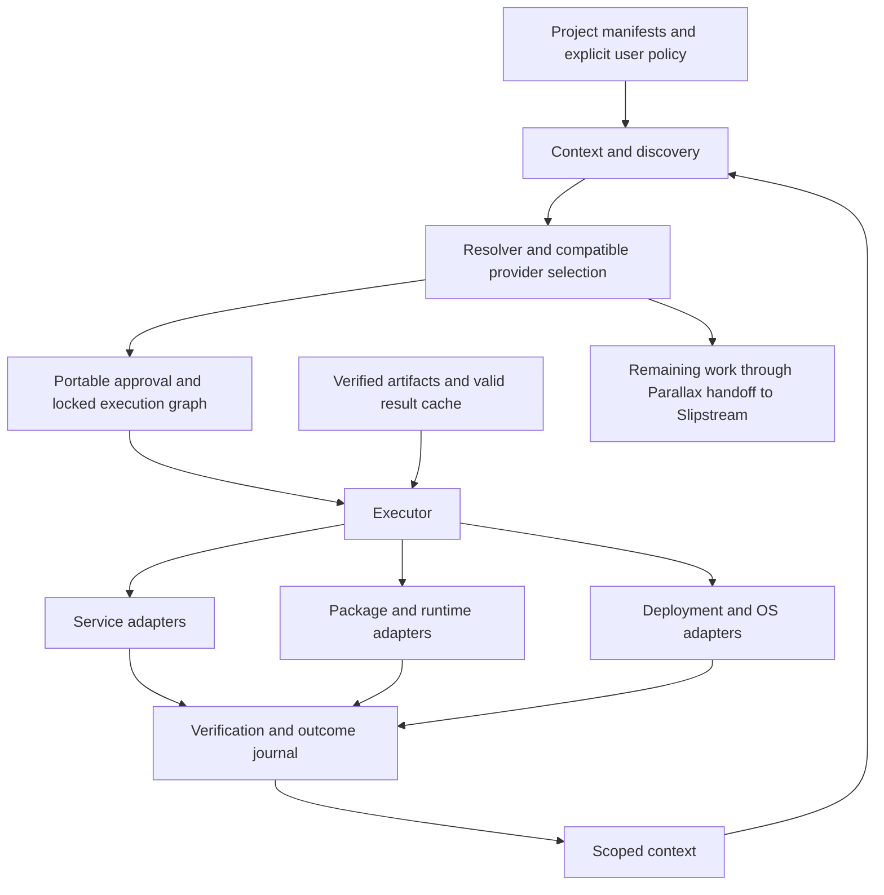

# Archer product and technical design

Design baseline: 11 October 2026. Implemented baseline: [9192f3b](https://github.com/Parallax-Web-Services/archer/commit/9192f3bbce3c99fa14644012a08e8bd55823c239), the first Go core. Sections describing the target architecture and delivery gates are commitments for subsequent implementation, not features of that baseline.

The current checkout adds an initial [native worker adapter](PROTOCOL.md),
strict handoff/approval validation, a PHP transport bridge, and explicit discovery
states. That advances Gate 1; complete PHP recipe compatibility, catalog coverage,
and functional service readiness still require implementation. The checkout also
adds [frozen npm v3 replay](NPM.md) and [Composer replay](COMPOSER.md), the package
portion of Gate 2. Managed runtimes, authorized build orchestration, and service
contract readiness remain pending.

Archer is the solo installer and environment coordinator for Zefram. A developer should be able to check out an application, run `archer i`, and receive a usable environment without personally operating Composer, npm, Docker, Kubernetes, or apt. Archer first asks what the project needs and what the user can already use. It connects a suitable existing service, reuses compatible local software and verified cached work, and installs or builds only what remains. Slipstream handles genuinely unresolved work after those routes have been exhausted.

The Go core implements explicit requirements, service discovery, live checks, verified executable caching, scoped installation, outcome memory, and locked PHP/npm dependency preparation. The frozen Zefram application now passes its PHP/JavaScript tests with both trees installed by Archer. A complete fresh-host journey still needs managed runtimes and authorized build/readiness execution through the same interface.

## The product contract

Archer owns the transition from a project's declared requirements to verified usable capabilities. Zefram supplies the application and its intent. Parallax supplies discoverable products and services. Slipstream coordinates work and receives requirements Archer cannot deterministically satisfy. Archer owns local environment preparation and records the evidence for each result.

One interface can cover several implementations. A database requirement may resolve to a team service; a PHP runtime may resolve to a managed binary; a library dependency still needs compatible package files. A deployment adapter may operate a container runtime or a cluster API. The user sees the chosen route, its effects, and its outcome through Archer. The underlying infrastructure still needs credentials, ownership, and operational policy.

The product has six observable obligations:

1. **Reuse first.** A suitable authorized service prevents a duplicate local build or installation. A discovery failure does not prove that no service exists.
2. **Preserve meaning.** A package imported by application code cannot silently become a remote API. Substitution requires an application contract that permits that delivery method.
3. **Explain the work.** Every requirement has a chosen route or a specific blocker. Planned work and verified satisfaction remain separate.
4. **Make repetition cheap.** Repeated runs reuse verified artifacts and valid results. They do not repeatedly download, compile, or ask a model to solve the same problem.
5. **Learn within scope.** Successful choices and explicit preferences improve selection for that user, team, and project. Learning never supplies permission or overrides compatibility checks.
6. **Leave a recoverable state.** Failures retain evidence for the verified subset and identify exactly what remains. Archer distinguishes resources it owns from resources it merely uses.

Generative AI is the final problem-solving route. Missing credentials, stale discovery, unsupported version syntax, or a broken installer are ordinary blockers to diagnose; they do not justify generation.

## A complete Zefram journey

The target acceptance fixture is a Zefram application with PHP dependencies, frontend dependencies, one required external capability, and an application readiness check. Its manifests and lockfiles remain the source of package requirements. `archer.json` adds capability intent, explicit service bindings, environment policy, and Archer-specific recipes.

The existing command names support the intended sequence:

```sh
archer init
archer plan --json
archer i
```

In the completed product, `init` detects the project without changing its dependency meaning. Planning detects the actual execution host, reads package locks, checks team service bindings, and produces the remaining execution graph. Installation prepares required runtimes, materializes packages, connects services, executes permitted build steps, and verifies the application's declared readiness check. Running this in CI uses the same pinned inputs and policy.

For example, a project that needs PHP, Node, a frontend build, and a database should end with PHP and Node available in its managed environment, application libraries installed in compatible layouts, the frontend built, and the configured database verified through its adapter. The database step connects the existing team service. It creates no local database container. A second run performs current readiness and integrity checks while reusing the completed work.

The managed environment must also be usable. An installer cannot change its parent shell's PATH. The target `archer run <command ...>` launches application commands with the selected runtimes and environment; generated project launchers or explicit shell activation support direct use. The readiness check runs in that same environment. `archer run` and activation are proposed interfaces, not current commands. Today Archer prints managed binary paths for the user to add to PATH.

That is a target scenario. Current source can replay supported npm v3 and Composer locks, generate PHP autoloading, check existing PHP requirements, install raw executable recipes, and check a configured service's HTTP health. There is no managed runtime manager, frontend build executor, or application readiness orchestration. The acceptance fixture uses existing PHP/Node runtimes and separately executes its declared application checks.

## The implemented baseline

| Responsibility | Working behavior in v0.1.0 | Boundary that remains |
| --- | --- | --- |
| Project intake | Reads root Composer/npm dependency declarations into explicit package requirements and retains names and constraints | Does not consume lockfile graphs or preserve every ecosystem-specific installation rule |
| Service selection | Reads configured catalogs, requires a local binding, and verifies a same-origin health endpoint | Health proves endpoint availability, not tenant access, API compatibility, or a completed business operation |
| Local reuse | Runs explicitly declared argv probes on the current host | Probes are trusted project instructions; they are not sandboxed, and constrained capabilities await version resolution |
| Artifact installation | Obtains SHA-256-pinned raw executables and publishes them into a project-scoped bin directory | No archives, package trees, runtime provisioning, or build steps |
| Caching | Keeps catalog metadata for 300 seconds and shares a content-addressed artifact store; every byte-cache hit is rehashed | No installation-result cache, semantic recipe retrieval, or complete Slipstream cache integration |
| Context | Remembers successful provider bindings and at most 100 outcome events per project scope | No user profile inference, cross-project learning, or context reset command |
| Planning | Emits `archer.plan/v1`; an optional plan ID guards against changed inputs and selected routes | No package lock, execution DAG, or portable Slipstream approval adapter |
| Distribution | Builds six OS/architecture artifacts and provides versioned per-user POSIX/PowerShell bootstraps | Release assets are not published; signatures and native macOS/ARM validation are pending |
| AI | Emits eligibility information for unresolved capabilities and makes zero model calls | No model invocation or worker handoff implementation |

`plan`, `doctor`, and `i --plan` install no artifacts and persist no learned outcomes. They can refresh catalog cache, call health endpoints, and run declared local probes. `i` replans before applying raw artifact installations. `--approval PLAN_ID` checks drift when supplied; the CLI does not require it for ordinary installation.

The source boundaries are small and explicit: [CLI](../cmd/archer/main.go), [project and plan types](../internal/archer/model.go), [selection and installation](../internal/archer/engine.go), [context](../internal/archer/context.go), [catalogs](../internal/catalog/catalog.go), and [artifact store](../internal/store/store.go). The Go module has no third-party dependencies. This keeps bootstrap independent of PHP and Node; it does not make their package ecosystems trivial to implement.

Go is an implementation and development dependency, not an end-user prerequisite. Installation distributes a standalone prebuilt executable, and normal Archer commands do not locate or invoke the Go toolchain. Building from source remains an optional path. PHP, Node, extensions, and native build tools belong to the selected application's runtime or build requirements; Archer must discover or prepare those separately.

## Target architecture

The core remains deterministic. Ecosystem-specific adapters supply discovery, compatibility, execution, and verification behind a shared plan. The diagram describes the target architecture. Native handoffs and initial npm/Composer replay backends exist; full package compatibility, runtimes, deployment, result caching, and callback orchestration remain pending.



### Requirements and service substitution

A requirement needs a stable identity, a delivery kind, compatibility constraints, and a verification contract. The current `delivery` values are `service`, `local`, and `package`. Runtime and deployment requirements will need additional typed contracts through additive fields or a new schema version.

Service selection must establish three different facts. Discovery establishes that a provider advertises a capability. Binding establishes the intended account, endpoint, and permitted access. Readiness establishes that the bound provider can fulfill this requirement. The catalog never grants access on the user's behalf.

The target service adapter checks the requested API or protocol version, required operations, tenant access, data location policy, and a harmless functional test where available. A database wire protocol, an object storage API, and a hosted business microservice have different tests. A provider's capability name alone cannot establish equivalence.

The current exact capability match and HTTP 200 check are an initial selection mechanism. Before production use, adapters must strengthen that evidence. A catalog also needs a declared coverage scope and freshness: which team, environment, capability families, and providers it represents. Without that, an empty result cannot establish awareness of the entire Parallax ecosystem.

The current checkout distinguishes `not configured`, `unavailable`, `stale`, `fresh with no suitable match`, and `fresh with an inaccessible match`. Missing configured discovery blocks unrestricted installation and AI eligibility. An explicitly local requirement can follow local policy, and a configured verified service or live local capability can still be reused. A fresh configured source set does not establish complete ecosystem coverage; that stronger catalog contract remains pending.

### Resolve and lock before applying

The target resolver constructs a graph whose nodes have declared prerequisites, exact inputs, destinations, allowed effects, and postconditions. A service binding, runtime installation, library tree, and application build are separate nodes. Dependencies must be ready before dependent work starts; independent downloads can run concurrently with bounded resource use.

`archer.json` declares intent. A future `archer.lock` records the reproducible choices: ecosystem package graph, immutable artifact/source identities, runtime versions, platform variants, service contract identities, and adapter versions. Credentials and live health results do not belong in it. Existing Composer/npm locks are imported with their meaning preserved; conflicts require explicit update rather than silent resolution.

A plan ID answers whether reviewed inputs and selected routes have changed. A lockfile answers which exact dependencies should be materialized. Neither answers whether the execution is authorized, whether a publisher is trusted, or whether a service is ready now. Those are separate checks.

Today, the local plan ID includes project source hashes, scope, context revision, host platform, selected routes, and service descriptors. It is tied to the local project identity and is not a portable package lock or a substitute for Slipstream's approval format.

### Execution and recovery

Each target adapter exposes five operations: discover candidates, resolve compatible inputs, describe effects, apply the selected route, and verify its postconditions. The core schedules and journals those operations. It does not accept catalog-supplied shell commands or credential-variable names as executable authority.

Local installation stages files in managed directories, verifies contents, and publishes the completed result. A package tree needs a single tree-level publication boundary; the current store guarantees publication only for individual files. Runtime switching and application activation must occur after dependent verification succeeds.

External operations need idempotency identities and ownership records. A reused team database is not owned by the current installation. A newly provisioned resource is owned only according to the authorized task and its retention policy. Remote provisioning, migrations, and native package changes can have effects that cannot be rolled back automatically; the plan must declare the recovery action instead of promising a universal undo.

Docker, Kubernetes, and OS adapters belong behind this same interface. They detect and use existing compatible infrastructure first. If required infrastructure is absent, they either provision it under an explicit policy or return a concrete blocker. Privileged changes, purchases, destructive actions, and application migrations require the appropriate task authorization. Removing the need to operate those tools manually does not make those effects implicit.

## Slipstream and Parallax integration

Slipstream already has a PHP Archer implementation and published-in-repository protocol contracts. The new Go core is a clean implementation with a different local configuration format. The native adapter now understands Parallax stdin/stdout requests, but uses its own recipe dialect and explicit approval marker. It does not automatically replace the existing PHP worker. The migration must preserve the integration contract while replacing the installation engine.

| Existing contract | Meaning the Go adapter must preserve |
| --- | --- |
| `parallax.resolution/v1` | Separates verified satisfaction, installable routes, and remaining requirements; installability is not completion |
| `parallax.handoff/v1` | Transfers one step to a single owner with stable handoff identity, requested work, context references, and bounded attempts |
| `parallax.handoff-result/v1` | Partitions requested work into verified satisfaction and remaining work, retains matching evidence, and names the next owner |
| `archer.approval/v1` | Binds operation, requirements and dependency closure, manifest hashes, selected route hashes, and version constraints |

The adapter must validate the original envelopes and retain additive extension fields. It must use the existing canonical JSON rules for approval hashes: recursively sorted object keys, preserved list order, unescaped Unicode and slashes, and no whitespace. Go's current project/plan JSON is not assumed to produce those same hashes. Shared fixtures and cross-language tests must demonstrate compatibility.

Planning on a server cannot establish installed state on the worker. The worker detects its actual host and verifies its current environment. Approved recipes and routes are validated before their trusted verification commands run. Compatible software already present may skip an approved installation; it cannot authorize a different installer. The existing preflight behavior is part of the migration contract.

Slipstream persists the handoff and atomically claims the task. Archer validates ownership and executes the assigned subset. A result retains every requested requirement exactly once, including the verified subset after failure. The caller persists history so unchanged work cannot circulate indefinitely. Protocol validation supplies no distributed lock by itself.

When deterministic work is exhausted, Archer returns remaining intent with its reasons and evidence. Slipstream may retrieve an existing solution or invoke generation under its policy. A generated solution returns as a proposed recipe or code change with declared inputs and effects. It passes review and verification before execution; a successful repeatable solution can then enter the ordinary recipe/result cache. Archer's installation engine does not need a model in its execution path.

The source contracts are [Slipstream Archer](https://gitlab.com/parallax-web-services/slipstream/-/blob/5a7224e080d3ce10de402f306bad0be2cd3f63b2/docs/archer.md) and [Parallax protocol](https://gitlab.com/parallax-web-services/slipstream/-/blob/5a7224e080d3ce10de402f306bad0be2cd3f63b2/docs/parallax-protocol.md), reviewed from the local checkout. Their URLs identify the repository revision; access follows that repository's permissions.

## Intelligent caching

Mirroring Slipstream means giving different kinds of cached knowledge the right identity, freshness, and scope. It does not mean trusting every previous outcome or adding generation to the installer.

Slipstream's current [capability catalog](https://gitlab.com/parallax-web-services/slipstream/-/blob/5a7224e080d3ce10de402f306bad0be2cd3f63b2/app/Services/Missions/CapabilityCatalog.php) distinguishes fresh discovery from stale or unavailable providers. Its default catalog freshness is 300 seconds. Archer follows that freshness boundary while adding credential/team scope to cache identity. Neither a warm cache nor an old provider choice proves present access.

Slipstream also has a concrete reuse policy in its [kit design](https://gitlab.com/parallax-web-services/slipstream/-/blob/5a7224e080d3ce10de402f306bad0be2cd3f63b2/docs/kits-structure.md): use a maintained base, retain files that repeat across projects, and generate the project's domain-specific remainder. Archer should resolve and apply compatible maintained recipes and kits before asking for a new solution. Kit application must pin the base revision, retain provenance, declare file collisions, and convert executable instructions into the reviewed plan. The Go core has no kit adapter today.

Two other existing Slipstream boundaries matter: [repository mirrors](https://gitlab.com/parallax-web-services/slipstream/-/blob/5a7224e080d3ce10de402f306bad0be2cd3f63b2/app/Services/Git/RepoCache.php) serve warm repository data and refresh when required, while the [source store](https://gitlab.com/parallax-web-services/slipstream/-/blob/5a7224e080d3ce10de402f306bad0be2cd3f63b2/app/Services/Missions/SourceStore.php) deduplicates content within owner/team identity. These support reuse with provenance and scope. They do not establish a semantic model-response cache that Archer can claim to reproduce.

The target hierarchy is:

| Cache layer | Reuse identity and invalidation | Implementation state |
| --- | --- | --- |
| Discovery metadata | Catalog source, credential/team scope, coverage, and expiry; refresh failure retains a stale diagnostic | Implemented with source and credential/team identity plus a fixed 300 second TTL; coverage contract pending |
| Artifact bytes | Content digest; verify bytes on each reuse, independent of download location | Implemented SHA-256 store for raw artifacts |
| Prepared package/runtime trees | Exact package graph, artifacts, adapter version, platform/ABI, and relevant preparation policy | Pending |
| Deterministic build results | Source tree, dependency lock, runtime/toolchain, declared environment inputs, target, and action definition | Pending |
| Reusable solution knowledge | Capability contract, context boundaries, recipe provenance, compatibility, and verification results | Pending; retrieved proposals still need current validation |

Mutable files, build outputs, and tenant-specific results cannot be treated like immutable download bytes. Shared package trees must not expose one project's modifications to another. Private outputs must remain within their authorization boundary; possession of a digest is not permission to retrieve them. Cache keys must include declared inputs, and undeclared inputs must prevent a claim of reproducibility.

The current per-digest lock prevents concurrent downloads of the same raw artifact. The target action lock coordinates identical preparation or build work and publishes one complete verified result. Failed or abandoned work never becomes a cache hit. Stale catalog evidence cannot authorize installation or generation merely to avoid a network error.

This is the required hierarchy. v0.1.0 implements the first two layers; complete Slipstream cache parity is not established.

## Learning the user context

Useful context consists of observed project manifests, host capabilities, explicit account bindings, approved policies, successful choices, and relevant failures. The target system stores those as typed facts with source, scope, observation time, and expiry where applicable. It should not need a model to infer which PHP version a lockfile requires or which database the project explicitly names.

The precedence is explicit project intent and organizational policy, locked compatibility choices, fresh observations, then learned preferences among equally permitted compatible routes. A remembered service can be checked first; it must still pass readiness. A previous privilege grant does not authorize a new unrelated task. An outage remains an outage even if the provider usually works.

Current memory is narrower: the key combines project location and scope; records contain provider bindings and a bounded outcome history. Remembered service bindings affect service candidate ordering. Planning reads memory without recording outcomes. Installation records verified successes after the installation loop completes. An early execution failure returns its verified subset but currently does not persist those outcomes into context. Moving a project changes its local identity.

User/team profiles, portable project identity, reset controls, and failure-based preferences are pending. Slipstream already defines [parallax.personalization-profile.v0.1](https://gitlab.com/parallax-web-services/slipstream/-/blob/5a7224e080d3ce10de402f306bad0be2cd3f63b2/app/Services/Personalization/ProfileDocument.php), with evidence-backed preferences, explicit or inferred basis, scope, counterevidence, and supersession. An Archer profile adapter should preserve that evidence and exclusion behavior rather than invent an incompatible user profile. Imported excerpts remain source data; they do not grant execution authority.

Before expanding learning, Archer needs inspect/export/reset operations and a policy for cross-project sharing. The existing `archer context` exposes current scoped records. Credentials remain external references, not learned facts. No background scan of unrelated user data is necessary for installation.

## Replacing Composer and npm

The first package milestone should replay existing locks before attempting a general solver. Exact locked inputs give a bounded compatibility target and a measurable path from checkout to working application. The implementation remains Archer's engine rather than a permanent wrapper that delegates ordinary installs to Composer or npm.

The first end-to-end target is Linux/amd64 with one frozen application repository revision and its committed locks. Runtime versions, PHP extensions, required package features, the bound service, and the readiness command must be recorded with that fixture before implementation begins. Windows/macOS application support follows native acceptance runs; cross-built Archer binaries alone do not establish it. This confines the first compatibility claim while leaving the current standalone-artifact CLI available across its build targets.

Locked replay must preserve production, development, optional, and platform dependency distinctions. The selected install mode and script policy become explicit plan and cache inputs. The current importer collects root declarations into one requirement list; that list is insufficient to reproduce either ecosystem's full installation semantics.

For PHP, that milestone must obtain the locked package graph, validate PHP and extension requirements, materialize `vendor`, generate compatible autoloading and executable links, and handle the selected application's install hooks through explicit policy. Composer's [documented install behavior](https://getcomposer.org/doc/01-basic-usage.md) uses the lockfile's exact versions and generates the application autoloader; matching those outcomes is part of Archer's compatibility target.

For Node, it must preserve the selected lockfile graph, package integrity metadata, dependency placement, executable links, optional/platform dependencies, and the fixture's lifecycle/build behavior. Peer dependencies and workspaces must either be supported with tests or produce precise unsupported-feature errors. npm's [clean installation contract](https://docs.npmjs.com/cli/v11/commands/npm-ci/) rejects inconsistent manifests and locks and keeps installation frozen; Archer's locked mode must likewise reject drift rather than silently update.

Archive extraction must reject escaping paths and unsafe links, enforce size limits, and stage complete trees before publication. Native modules and PHP extensions require an ABI-compatible runtime and possibly a toolchain. A supported prebuilt artifact can avoid compilation; otherwise Archer must declare the build prerequisites and resulting effects. Arbitrary scripts are not trusted merely because they came from a package archive.

General version solving, alternative repository types, broad plugin support, and cross-ecosystem update operations follow the locked fixture. Unsupported constructs remain explicit. The first release must publish a tested compatibility matrix rather than imply support for every project with a `composer.json` or `package.json`.

## Distribution and release trust

The initial distribution is a per-user, versioned bootstrap in the nvm and Composer style. POSIX and PowerShell scripts choose a prebuilt platform artifact, verify its SHA-256 against the release manifest, retain versioned installations, and provide a launcher and PATH instruction. This path requires no Go toolchain. Go is needed only for optional source builds and development. Package-manager listings can follow once this path is stable.

The [v0.2.0-alpha.1 prerelease](https://github.com/Parallax-Web-Services/archer/releases/tag/v0.2.0-alpha.1) distributes six raw binaries and `SHA256SUMS` through a tagged release workflow. The bootstrap obtains the selected artifact from that release or accepts a prepared local release directory through `ARCHER_DIST_DIR`; both paths avoid requiring the user to compile Archer. Windows/amd64 and Linux/amd64 have native execution checks. Darwin and arm64 artifacts are cross-built, which does not establish native application support. The current scripts avoid elevated privilege and shell startup edits and preserve unmanaged conflicting paths.

Checksums establish consistency with the manifest. Release trust also needs signed publisher metadata, immutable release policy, a reproducible build record, supported upgrade/rollback behavior, and native validation for claimed platforms. Those are release gates, not properties established by hashing an asset downloaded alongside its manifest.

## Proof of usefulness and delivery gates

The baseline has 38 Go tests and 18 bootstrap cases exercised during development, plus native Windows/Linux installation and offline-reuse smoke checks. Tests cover service-before-install selection, stale discovery, package/service separation, approval drift, corrupted cache bytes, concurrent publication, scoped memory, and partial failures. Six artifacts were cross-built and hash checked. That evidence supports the small current boundary; it does not prove full package compatibility or speed superiority.

Performance should be measured on the same real application, host, network conditions, and resulting dependency state. Compare Archer with the project's normal Composer/npm commands for cold installation, warm repeat, changed lock, offline warm installation, and concurrent projects sharing dependencies. Record elapsed time, bytes fetched, cache hits, executed build steps, peak resources, and model calls. Publish results with fixture and machine details. The [Zefram acceptance record](VALIDATION.md) captures npm and combined PHP/npm cold/offline CLI timings with passing application tests and builds. No comparative Composer/npm speedup has been measured yet.

The strongest first acceptance test is functional: on a fresh supported user environment, the real fixture becomes runnable using Archer alone; its existing Parallax service is reused; required packages and runtimes are ready; application tests pass; repeating the run fetches no unchanged artifact bytes and executes no unnecessary build. Offline testing applies to local work with complete cached inputs; it cannot assert live readiness of a remote service.

| Gate | Concrete deliverable | Evidence required before claiming completion |
| --- | --- | --- |
| 1 Protocol and discovery | Go adapters for existing Parallax envelopes, portable approvals, worker preflight, catalog coverage, and service readiness | Shared PHP/Go fixtures; exact result partitions; approval drift rejection; no fallback on unknown discovery |
| 2 Real Zefram installation | Managed PHP/Node runtimes and lock replay for one checked-in representative application | Fresh-host preparation with `archer i`; compatible library layouts; application tests; no direct Composer/npm operation by the user |
| 3 Repeated work reuse | Prepared-tree and build-result caches, bounded action concurrency, scoped context controls | Warm/offline local runs; changed-input invalidation; concurrent projects; private output isolation |
| 4 Environment adapters | Required service, container, cluster, and OS routes for the supported application scenarios | Authorized effects; readiness checks; ownership journal; failure and recovery exercises; no manual infrastructure commands in the supported journey |
| 5 Release and expansion | Published trusted bootstrap assets, native platform matrix, benchmarks, and declared package compatibility | Install/upgrade/rollback tests; published measurements; supported/unsupported feature matrix; additional real application fixtures |

Gate 2 is the threshold for calling Archer a useful Zefram installer. General replacement claims require the wider compatibility and environment evidence in later gates. AI fallback is added only after unresolved work can travel through the existing protocol with complete reasons, bounded attempts, and verifiable results.

The immediate implementation sequence is protocol compatibility and discovery correctness, then the locked PHP/Node application slice. That sequence turns the current safe byte installer into a product a developer can depend on while keeping the service-first and cache-first decisions intact.
